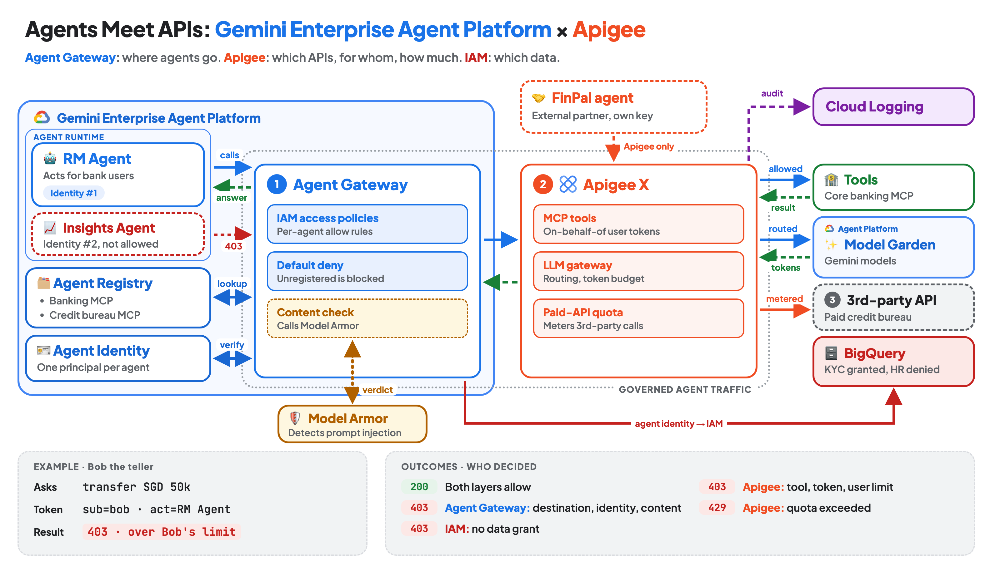
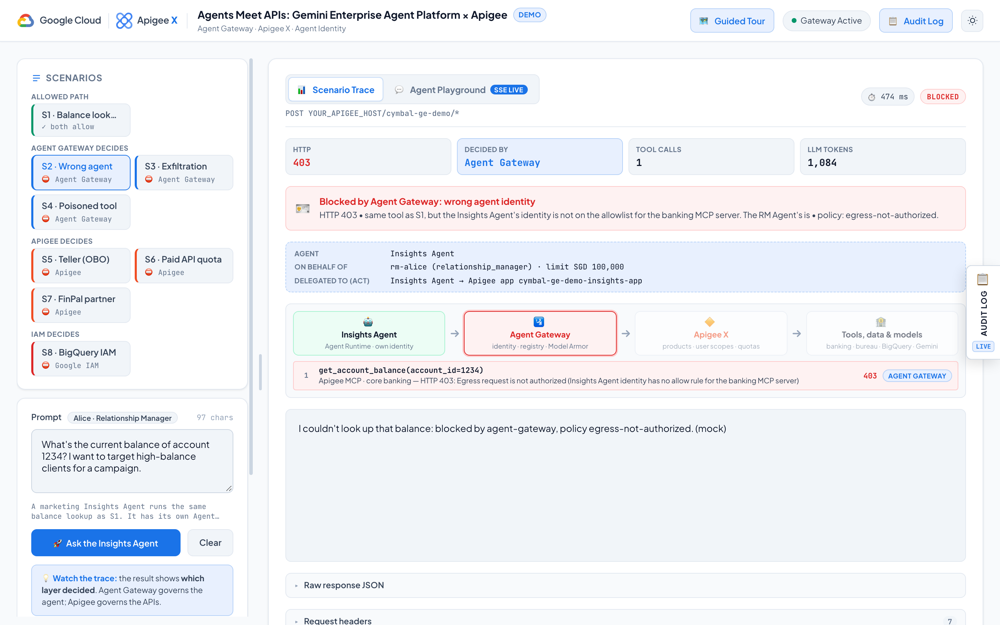

# Agents Meet APIs: Gemini Enterprise Agent Platform × Apigee

> Agent Gateway decides **where agents may go**. Apigee decides **which APIs, for whom, and how much**. IAM decides **which data**.


[](LICENSE)

> [!IMPORTANT]
> **This is not an official Google product.** It is a demo / reference implementation provided as-is,
> without warranty or support, and is not intended for production use. All banking data is fictional.

## Intention

When AI agents start calling business APIs on behalf of people, three questions need separate answers:
*may this agent reach that destination?*, *may this app and this user do this, and how much?*, and
*which data may this agent read?* This demo uses a fictional bank, **Cymbal Bank**, to show how
**Agent Gateway** on Gemini Enterprise Agent Platform, **Apigee X** and **Google Cloud IAM** each answer one
of them, and how the web UI shows which layer made each decision. It is for architects and platform teams
designing agent governance, and it shows that Apigee keeps owning API products, delegated user access and
API economics when the caller is an agent.

**What you will see:**

- An ADK **RM Agent** on Agent Runtime, with its own **Agent Identity** and all egress forced through **Agent Gateway**
- Agent Gateway blocking the **wrong agent**, an **unregistered destination** (data exfiltration), and a
  **poisoned tool response** (its content check calls **Model Armor**)
- Apigee as **MCP server** and **LLM gateway**: per-product tool filtering, **on-behalf-of user tokens**
  (`sub` = user, `act` = agent), per-user transfer limits, and a **paid third-party API quota**
- A **partner agent** outside Google Cloud using the same tools through Apigee only
- The agent querying **BigQuery as itself**: IAM grants its identity one table and refuses the other
- A **guided tour** and an **audit log** showing which layer decided each request

## Architecture



1. **Agents on Agent Runtime.** The RM Agent (allowed) and a marketing Insights Agent (not allowed to bank)
   run on Agent Runtime. Each one is its own principal (Agent Identity). There are no service-account keys.
2. **Agent Gateway** is the only way out. Agent Registry lists the approved destinations, and IAM access
   policies (per agent identity) decide who may reach them. Anything else is denied by default. A content-check
   policy sends MCP `tools/call` requests and responses to **Model Armor** for a verdict.
3. **Apigee X** fronts every API the agent uses:
   - the banking **MCP server** (API products filter the tools; on-behalf-of user tokens carry user scope and limits)
   - the **LLM gateway** to Gemini on Vertex AI (Model Garden): model routing and a token budget
   - the **paid credit bureau** (a mock third-party API on Cloud Run) with a per-app quota
4. **FinPal**, a partner agent outside Google Cloud, has no Agent Gateway in its path. It calls the same MCP
   server through Apigee with its own key, product and quota.
5. **BigQuery**: the RM Agent reads a KYC table with its own identity. It has no grant on the HR table, so IAM refuses.
6. **Cloud Logging / audit log**: every decision carries `x-cymbal-decided-by` and `x-cymbal-policy`, so the UI
   and the logs show the deciding layer.

## How it works

### API reference (Apigee proxies, env `YOUR_APIGEE_ENV`)

| Proxy | Method + path | Caller credential | What it does |
|---|---|---|---|
| `cymbal-ge-demo-token` | `POST /cymbal-ge-demo/token` | web UI app key | Mints a 15-minute demo user JWT (`sub` = user, `act` = agent app); HS256 secret in an encrypted KVM |
| `cymbal-ge-demo-mcp-banking` | `POST /cymbal-ge-demo/mcp/banking` | agent or partner app key + `x-user-token` | MCP JSON-RPC server over mock core banking: `tools/list` filtered by product, `tools/call` checked against user scope and `transfer_limit` |
| `cymbal-ge-demo-llm` | `POST /cymbal-ge-demo/llm/v1/.../models/{model}:generateContent` | agent app key | LLM gateway to Gemini; alias `cymbal-auto` routes by prompt size; per-app token budget |
| `cymbal-ge-demo-credit-bureau` | `POST /cymbal-ge-demo/bureau/mcp` | agent app key | Paid third-party API: 3 `tools/call` per minute per app; response body passed through untouched (Model Armor must see it) |

Every Apigee decision sets `x-cymbal-decided-by: apigee` and `x-cymbal-policy: <reason>`. Blocked calls return
403 (authorization) or 429 (quota) with a JSON body. Policy names and keys never appear in responses.

```bash
# 1. Get an on-behalf-of token for Bob the teller, delegated to the RM Agent's app
TOKEN=$(curl -s -X POST "https://YOUR_APIGEE_HOST/cymbal-ge-demo/token" \
  -H "x-api-key: YOUR_WEBUI_API_KEY" -H "Content-Type: application/json" \
  -d '{"user": "teller-bob", "actor": "rm-agent"}' | jq -r .access_token)

# 2. Call an MCP tool as the RM Agent on Bob's behalf: SGD 50,000 is over Bob's limit -> 403 user-transfer-limit
curl -s -i -X POST "https://YOUR_APIGEE_HOST/cymbal-ge-demo/mcp/banking" \
  -H "x-api-key: YOUR_AGENT_API_KEY" -H "x-user-token: $TOKEN" -H "Content-Type: application/json" \
  -d '{"jsonrpc":"2.0","id":1,"method":"tools/call","params":{"name":"transfer_funds",
       "arguments":{"from_account":"1234","to_account":"5678","amount":50000,"memo":"demo"}}}'
```

### The agent

`agent/rm_agent` is an ADK agent whose tools are plain Python functions that speak MCP JSON-RPC over HTTPS.
Every tool returns `{ok, http_status, decided_by, policy, detail, data}`. `decided_by` comes from the
`x-cymbal-decided-by` header or body. A 4xx without that marker means Agent Gateway stopped the call.
The web UI's backend (`web-ui/server.py`, Python stdlib only) gets the user token, starts an Agent Runtime
session, streams the answer and turns tool events into the decision trace.

## Web UI



- **Header**: **Guided Tour** (6 short missions), the gateway status, the **Audit Log** drawer, and the light/dark toggle.
  The architecture diagram opens from the header.
- **Left panel: scenarios**, grouped by *who decides*: Allowed path, Agent Gateway, Apigee, IAM. Pick one,
  check the persona (Alice, Bob or the FinPal partner) and the prompt, then press **Ask**.
- **Main panel: Scenario Trace**
  - The status row shows the HTTP code, the deciding layer, tool calls and LLM tokens.
  - A verdict banner explains the decision in one sentence.
  - The identity box shows the agent, the user it acts for and the delegated Apigee app.
  - The decision trace runs Agent → Agent Gateway → Apigee → tools/data/models, with every tool call and the layer that stopped it.
  - Below are the agent's answer, the raw JSON and the request/response headers.
- **Agent Playground** tab: chat with the RM or Insights Agent live (streamed over SSE).
- **Audit Log** (right edge): every run, with the agent, the user and the layer that decided.
- **Guided Tour**: missions follow the scenario order. After each step the tour pauses on the result. The
  "What just happened?" panel can be dragged and minimised so it never hides the evidence.

## Repository structure

```
.
├── agent/                 # ADK RM Agent + Insights Agent (Agent Runtime) and deploy.py
│   ├── rm_agent/          #   agent, MCP client, tools, LLM-error classification
│   └── local_test/        #   offline tests against a mock Apigee
├── apigee/                # Apigee proxy bundles (token, mcp-banking, llm, credit-bureau, optional extproc)
│   └── tests/             #   offline unit tests of the bundled JavaScript
├── credit-bureau/         # mock third-party MCP server (Cloud Run) + deploy.sh
├── infra/                 # Agent Gateway, Agent Registry, access policies, Model Armor, BigQuery, teardown
│   ├── env.sh             #   project / region / naming used by every script
│   └── templates/         #   YAML/JSON templates rendered by the scripts
├── scripts/               # setup-apigee.sh, teardown-apigee.sh, test-apigee.sh, test-demo.sh, verify-scenarios.py
├── web-ui/                # house-style UI + stdlib backend; run-local.sh, deploy-cloudrun.sh
│   └── static/tour/       #   guided tour engine and missions
├── docs/                  # architecture.png (rendered from architecture-diagram.html), webui-screenshot.png
└── LICENSE
```

## Prerequisites

- A Google Cloud project with **billing enabled**, an **Apigee X** organization with an environment whose
  host has a valid public TLS certificate (the agent's egress needs it), and access to **Agent Runtime /
  Agent Gateway** on Gemini Enterprise Agent Platform in your region
- APIs (enabled by `infra/00-apis.sh`): `aiplatform`, `agentregistry`, `networkservices`, `networksecurity`,
  `modelarmor`, `iap`, `run`, `cloudbuild`, `artifactregistry`, `secretmanager`, `compute`, `dns`, `iam`,
  `logging`, `monitoring`, `cloudtrace`, `telemetry`, plus `apigee` and `bigquery`
- IAM for the operator: Apigee Org Admin, Network Services Admin, Service Extensions Admin, Network Security
  Admin, Model Armor Admin, Agent Registry Editor, Access Policy Admin, Project IAM Admin, Cloud Run Admin,
  Cloud Build Editor, Agent Platform User, BigQuery Admin (or Owner on a sandbox project).
  [infra/README.md](infra/README.md) lists every role and why it is needed.
- Local tools: `gcloud` (authenticated, with Application Default Credentials), `curl`, `jq`,
  Python 3.11–3.13 with [`uv`](https://docs.astral.sh/uv/), and Node.js (only for the Apigee bundle unit tests)
- **Estimated running cost** (demo scale): Agent Runtime scales to zero (min 0, max 2 instances). Agent Gateway
  bills per gateway and per request. Model Armor bills per sanitized token above the free tier (only MCP
  `tools/call` traffic). Apigee calls go to your existing org. Cloud Run (credit bureau and UI) is small.
  The UI keeps **1 warm instance** so the demo responds instantly. Gemini tokens are capped by the Apigee LLM
  budget. Tear everything down after the demo.

## Step-by-step setup

All scripts are idempotent and accept `--dry-run`. Run them from the repository root.

```bash
git clone https://github.com/welylau/apigee-geap-demo.git && cd apigee-geap-demo
# Set your project, project number, org id and region (every infra/ script sources this file)
$EDITOR infra/env.sh
export PROJECT_ID=YOUR_PROJECT_ID APIGEE_ENV=YOUR_APIGEE_ENV   # read by scripts/ and web-ui/
```

1. **Check org policy and enable APIs**

   ```bash
   ./infra/07-org-policy-check.sh      # read-only: access-policy bindings must not be blocked
   ./infra/00-apis.sh
   ```

2. **Deploy the mock credit bureau** (the paid third-party API)

   ```bash
   ./credit-bureau/deploy.sh
   ```

3. **Deploy the Apigee side**: KVM, proxies, API products, developer apps, keys in Secret Manager

   ```bash
   ./scripts/setup-apigee.sh
   ./scripts/test-apigee.sh            # acceptance tests for every Apigee decision
   ```

4. **Build the Agent Gateway side**: Model Armor template, gateway (IAP authorization in DRY_RUN),
   registry entries, IAM access policy, Model Armor content check, and the agent identity roles

   ```bash
   ./infra/01-model-armor.sh
   ./infra/02-agent-gateway.sh
   ./infra/03-registry.sh
   ./infra/04-uap.sh
   ./infra/05-model-armor-authz.sh
   ./infra/02c-agent-identity-roles.sh
   ```

5. **Deploy the agents** to Agent Runtime, bound to the gateway, then narrow the access policy to the RM Agent

   ```bash
   (cd agent && uv sync)
   agent/.venv/bin/python agent/deploy.py                   # RM Agent
   agent/.venv/bin/python agent/deploy.py --agent insights  # Insights Agent (scenario 2)
   ./infra/04-uap.sh                                        # re-run: least privilege
   ./infra/08-bigquery.sh                                   # KYC/HR demo tables + grant to the agent identity
   ```

6. **Enforce the gateway**: run the scenarios once while in DRY_RUN, check the IAP logs
   ([infra/README.md](infra/README.md#order-of-operations)), then switch to enforcement

   ```bash
   ./infra/02b-enforce-iap.sh          # --rollback reverts to DRY_RUN
   ```

7. **Run the web UI** locally, or deploy it to Cloud Run behind IAP

   ```bash
   ./web-ui/run-local.sh               # http://localhost:8080  (DEMO_MOCK=1 runs it with no cloud resources)
   DOMAIN=none IAP_MEMBERS=user:YOUR_EMAIL ./web-ui/deploy-cloudrun.sh
   ```

## Demo scenarios

| # | Scenario | What to try | Expected result |
|---|---|---|---|
| 1 | Balance lookup | Alice: "What's the current balance of account 1234?" | 200, both layers allow |
| 2 | Wrong agent | Insights Agent asks for the same balance as #1 | 403, Agent Gateway: its Agent Identity is not allowed |
| 3 | Exfiltration | Send transactions to `webhook.site` | 403, Agent Gateway (`egress-not-authorized`) |
| 4 | Poisoned tool | Credit report for CUST-666 | 403, Agent Gateway content check (Model Armor verdict) |
| 5 | Teller limit (on behalf of) | Bob transfers SGD 50,000 | 403, Apigee (`user-transfer-limit`); token: sub = Bob, act = RM Agent |
| 6 | Paid API quota | Credit reports for 4 customers | 3 ok, then 429, Apigee (`credit-bureau-quota`) |
| 7 | FinPal partner | Partner tools/list + 6 calls | 2 tools; 6th call 429, Apigee (no Agent Gateway in a partner's path) |
| 8 | Agent → BigQuery | KYC rating, then an HR record | KYC row, then 403 from Google IAM (agent identity has no grant) |

Scenarios 4 and 6 share the credit-bureau quota. Wait a minute between them.
Reliability check (5 rounds of all 8): `python3 scripts/verify-scenarios.py --bff http://127.0.0.1:8080 --rounds 5`

## Security notes

- **No keys in source or in the browser.** Apigee app keys live in Secret Manager. The JWT signing secret lives
  in an encrypted Apigee KVM. The UI backend never sends keys to the browser.
- **No service-account keys for agents.** Each agent authenticates with its own Agent Identity, and IAM grants
  it only what it needs (one BigQuery table, specific secrets).
- **Default-deny egress.** The agents can reach only registered destinations and essential platform hosts.
- **Delegated tokens are bound to their agent.** The MCP server rejects a user token presented by an app
  other than the one named in `act`.
- The Cloud Run UI runs behind **IAP**. Delete it, or restrict `IAP_MEMBERS`, when it is not in use.
- `CUST-666` deliberately returns a **prompt-injection payload**, for testing Model Armor only.
- Demo API keys are scoped to a single API product. Rotate or delete them after the demo.

## Teardown

Each script asks y/N before every destructive step.

```bash
gcloud run services delete cymbal-ge-demo-ui --region YOUR_REGION --project YOUR_PROJECT_ID
./infra/99-teardown.sh --include-agent   # agents, gateway, policies, registry, Model Armor, BigQuery, credit bureau
./scripts/teardown-apigee.sh             # secrets, apps, developer, products, proxies, KVM
```

## License

Licensed under the [Apache License, Version 2.0](LICENSE).
